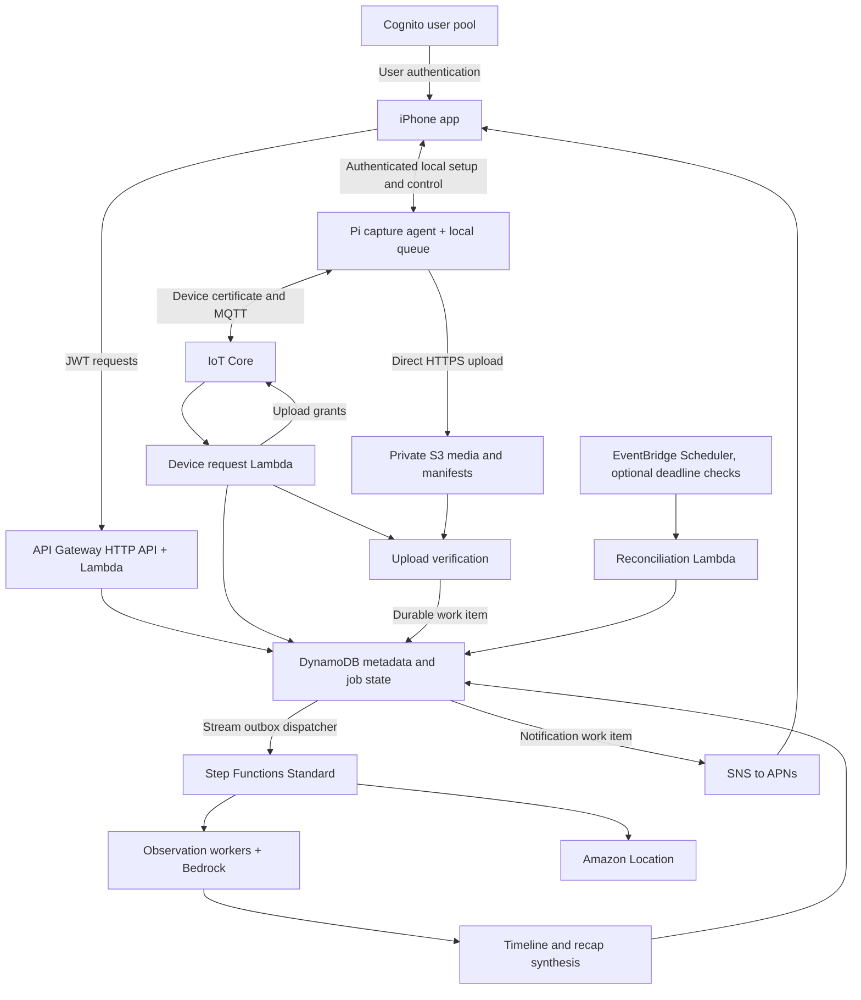

# Clippy architecture

Status: architecture baseline with P01-P03 implemented locally, 2026-11-07. See [STATUS](STATUS.md) for actual evidence and [local development](local-development.md) for runnable commands. AWS, hardware, and platform integrations below remain later-phase designs. Confirmed product requirements are in [decisions](decisions.md). Technical defaults below guide implementation; changes must be recorded with a reason.

## 1. Experience and boundaries

The primary experience is a daily journal: capture moments, review the day, correct interpretations, and reflect. Coaching is optional and secondary. A photograph is partial evidence; a calendar event is a plan. Neither proves attendance, emotional state, productivity, or a complete account of the user's day.

The initial product supports one active owner per device and one active device per user. Identity and storage keys must still isolate different users from the first backend implementation. Multi-device day merging is a later feature, not an assumption hidden in MVP code.

The device captures still images at a configurable interval, initially proposed as ten minutes during enabled capture hours. This is not continuous video recording. Location changes enrich moments independently of the photo interval. Audio capture, face identification, always-on cloud streaming, and autonomous account actions are outside the first version.

## 2. Components and stack

Use a monorepo with these planned boundaries:

```text
apps/ios/                 SwiftUI app, platform adapters, UI tests
services/backend/        TypeScript Lambda handlers and domain services
services/processing/     TypeScript observation, timeline, recap workers
device/                  Python device application and hardware adapters
infra/                   AWS CDK v2 in TypeScript
contracts/               OpenAPI, JSON Schema, protocol examples
fixtures/                Synthetic cross-component fixtures
tools/                   Explicit local checks and simulator commands
docs/                    Architecture, decisions, stages, evidence
```

Choose SwiftUI for the native iPhone experience; Swift concurrency and protocol-based services keep views separate from I/O. Use an actor-owned local persistence layer, initially SwiftData, for cached days and an outbox of pending user edits. Store authentication material in Keychain, not the journal store.

Choose TypeScript for API/processing Lambda handlers and CDK so backend contracts and infrastructure stay in one language. Use AWS SDK v3 at adapter boundaries. Choose Python for the Pi because camera and sensor adapters are likely to be easier to integrate there. Use SQLite for the durable local queue and metadata; store image bytes separately.

Pin compatible toolchains, SDKs, and lockfiles in P02 after checking the chosen Xcode and Raspberry Pi OS. Proposed deployment target is iOS 18 or newer; the hardware owner and team must confirm that before project generation. Do not copy version numbers from this planning document as current SDK recommendations.

## 3. AWS composition



S3 is the media data path; IoT is the device identity and control path. The app never needs an AWS administrator credential, and images do not travel through API Gateway or MQTT.

- **IoT Core:** one device identity and certificate, narrow topics, reported state, and versioned desired configuration. Bulk images remain outside MQTT. Treat its shadow as last reported state, not a live sensor reading.
- **S3:** private media, immutable upload manifests, and larger model artifacts. Use separate ingress and derived prefixes or buckets to prevent processing loops. Short-lived read URLs are issued only after ownership checks.
- **Lambda on demand:** API handlers, IoT requests, manifest verification, model adapters, notification dispatch, and deletion tasks. The workload is intermittent and should not require an always-running EC2 server.
- **Step Functions Standard:** a visual workflow for validation, bounded parallel image analysis, timeline construction, recap synthesis, and failure recovery. This explicitly chooses a workflow the team can inspect. Lambda Durable Functions is a future alternative if orchestration is moved into code; do not operate both for the same pipeline.
- **DynamoDB on demand:** owners, devices, days, captures, job state, corrections, reflections, and outbox records. Access patterns are known by user/device/day; do not add a vector store for the MVP.
- **API Gateway HTTP API:** native JWT authorization in front of Lambda. Validate issuer, audience, expiry, required scopes, request schemas, and ownership. Enforce access-token semantics so an identity token is not accepted accidentally. REST API is only warranted if a required capability such as direct WAF integration or usage plans changes this decision; do not assume HTTP API supports every REST API feature.
- **Cognito:** user authentication. Use authorization code with PKCE and a public native client without a client secret. Amplify Auth can manage sessions; app API access goes through a typed HTTP client. Do not introduce AppSync/DataStore in parallel with the planned REST API.
- **IAM and KMS:** distinct execution roles and scoped data access; private encrypted storage. S3 presigning roles must not be general bucket administrators.
- **Amazon Location:** reverse geocode meaningful location samples and cache results per owner/location precision. Return an approximate label with a correction path; it does not supply the GPS signal.
- **SNS/APNs:** a generic recap-ready push. The app fetches authorized content after opening. Push delivery is advisory, not the source of truth or a prerequisite for seeing a recap.
- **Secrets Manager:** any future mail-provider credentials and backend-only secrets. Device private keys stay on the device; Wi-Fi credentials never need to reach AWS.
- **CloudWatch:** operational metadata, metrics, and alarms without photo contents, calendar text, email text, tokens, or signed URLs.
- **SQS recovery queue:** retain failed stream/outbox dispatch work with an operator-visible receipt. Filter stream handlers by record kind so state/notification updates do not recursively start processing. Pair retries with a documented reconciliation path; a stream alone is not indefinite recovery storage.
- **EventBridge Scheduler:** optional cloud reconciliation/deadline checks with explicit timezone behavior. It does not wake an offline Pi. Activation is a separate approved operation.

Use CDK with a persistent Data stack and a Runtime stack to begin. Data owns buckets, KMS keys, and tables; Runtime owns API, functions, workflow, IoT rules, and notification integrations. Avoid an unnecessary stack per service. Keep persistent resources retained and use deletion workflows for user data, not stack destruction. See [sources](sources.md) for service behavior.

## 4. iPhone layout and state

**Home** presents the latest completed recap with its date, a concise summary, key moments, a timeline, and a reflection prompt. A separate status area shows current capture knowledge and Sync now. If the user requests a daytime recap, label it Today so far and display its coverage time. Never label yesterday's recap as today's activity.

**History** presents a calendar/list of days with ready, partial, empty, and unavailable states. Day detail reuses the Home recap component. A moment opens source images, timestamps, approximate place, observation/inference labels, and correction/deletion actions.

**Device** presents last contact, battery and queue counts with observation timestamps, configuration, manual sync, automatic-sync preferences, pairing, disconnect/reset guidance, and capture-pause state. Integrations and retention controls live here initially.

Required screens: onboarding explainer, sign-in, QR scan, local pairing, Wi-Fi setup, permission explanation, test sync, Home, day detail, moment detail, reflection editor, History, Device, sync progress, Calendar selection, and data controls. Mail UI must remain absent or clearly unavailable until its capability gate passes.

View models depend on `JournalRepository`, `DeviceService`, `SyncService`, `CalendarService`, and `AuthSession`. They consume typed state, not SDK response dictionaries. The cache supports reading completed recaps offline. The edit outbox uses operation IDs and revision checks so a retry cannot duplicate a reflection or silently overwrite newer edits.

Keep four independent statuses: device capture state, upload state, recap-processing state, and calendar freshness. Uploaded does not mean analyzed. A recent calendar sync does not mean recent device contact. The screen on the wearable is authoritative for local pause while disconnected.

## 5. Device runtime

The device application has independent capture, gesture, display, storage, connectivity, and sync components behind interfaces. A supervisor routes events; a failed upload must not crash capture or unpause the camera. A small simulator implements the same interfaces.

Persist each capture's ID, local sequence, timestamp and clock quality, checksum, location sample reference, and queue state before considering it safely stored. Use an atomic image-file write followed by a database transaction; recover orphan files and incomplete records after reboot. Measure available storage and stop capture visibly before running out. Never silently delete unacknowledged images to make room.

Gesture handling is local and initially rule-based. Define deliberate activation and separate resume behavior. Persist pause state across a reboot; an uncertain restart must not unexpectedly resume capture. A pause stops acquisition, rather than capturing and hiding frames. Show a clear icon/text indicator and any explicit pause expiration on the screen. Pause controls future capture; queued captures can still sync unless the user separately cancels sync or deletes them. Explain those controls distinctly. Sampling raw IMU data for later gesture training is an optional, bounded diagnostic, not an always-on upload feature.

Encrypt local image storage. P01 must select a key strategy compatible with unattended startup and the actual hardware. A key stored on the same removable media as its ciphertext does not provide strong protection against physical theft; document the residual risk if no secure key store is available. Do not claim hardware-backed key protection without hardware evidence.

## 6. Pairing, provisioning, and ownership

For the first prototype, use a unique device key/certificate provisioned during an approved developer setup. Keep the private key on the Pi and register only the matching public identity with AWS. Fleet provisioning is a scale-up path; never place a reusable administrative credential in firmware or a QR code.

Pairing must work before the device knows Wi-Fi:

1. The user signs into the app. The unclaimed device displays an expiring setup QR containing its public identifier and an ephemeral pairing challenge or secret.
2. The app scans it and establishes an authenticated local session. Proposed transport is BLE, subject to hardware confirmation. Use established secure pairing primitives and a reviewed out-of-band authentication design; do not invent a cryptographic protocol.
3. The local session provisions Wi-Fi. Credentials remain on the phone/device and are excluded from cloud requests and logs.
4. Once online, the device proves its provisioned identity to IoT and reports the claim challenge. The phone submits the matching claim through its authenticated API session.
5. The server atomically binds the unclaimed device to the user only after both sides match and physical possession is confirmed through the agreed device interaction. A second claimant loses the conditional write.
6. Both ends store the resulting ownership epoch and configuration revision. Failed/expired setup can restart safely without creating multiple owners.

A printed serial number alone is not proof of possession. Re-pairing an owned device requires owner authentication or an explicit reset/transfer flow. Transfer revokes old local pairing material, separates new object namespaces with a new ownership epoch, and prevents new owners from seeing old data. A cloud unlink cannot immediately erase an offline device; show pending device cleanup honestly.

## 7. One sync engine, two triggers

Manual and nightly sync create the same durable request. Manual requests may arrive through the app API/IoT while online or over authenticated BLE nearby. BLE is a control path; the Pi still needs Wi-Fi or a configured hotspot for S3 uploads. Remote sync while the Pi is offline is unavailable, and the UI must say so. A cloud request can remain pending only until an explicit expiry.

Nightly timing runs locally on the Pi using a user-configured IANA timezone and schedule revision. Use one persisted execution key per local service date. For a nonexistent spring-forward time, run at the next eligible time; for a repeated fall-back time, run once. Resume a missed eligible upload on reconnect. Do not backfill an unbounded number of scheduled jobs. Travel/timezone changes apply prospectively and are recorded.

The user can disable automatic sync in Device settings. That stops new scheduled runs once acknowledged by the device; an offline change shows Pending. Manual sync remains available. Canceling a current upload is a separate action and retains remaining captures. Charging is a default preference, not a claim that manual sync bypasses storage or battery safety limits.

For every run:

1. Freeze a bounded snapshot of queued captures and metadata up to a sequence cutoff. Capture may continue into the next snapshot.
2. Request upload grants in small batches. The backend derives the owner from the device binding and returns URLs only for that device/epoch/snapshot.
3. Upload each object directly to S3 with checksum and a conditional create. Checkpoint successful uploads locally. Renew expired grants only for missing objects.
4. Upload an immutable manifest, then send a completion request with its hash. This is a proposal of completeness, not trusted proof.
5. The backend checks every expected object, size, checksum, identity, and snapshot boundary. Reject arbitrary S3 paths and inconsistent manifests. A failure returns missing/invalid items without processing an incomplete upload as complete.
6. Persist a verified snapshot and a processing outbox record atomically. Only now acknowledge durable receipt. Local retention/cleanup follows the acknowledged policy; a PUT success alone never permits deletion.
7. A stream dispatcher starts the workflow. Repeated requests and events find the existing job. Reconciliation recovers an outbox item if dispatch failed; do not depend on a database update followed by an untracked best-effort workflow call.

P04 provides an explicit operator recovery command and failed-dispatch queue. Before unattended pilot use, P10 must either obtain approval for bounded automatic reconciliation or assign a concrete operator procedure and response target. Do not promise automatic recovery from a permanently missed dispatch without one of those paths.

Repeated taps coalesce with the active run. New captures beyond its cutoff stay queued. A manual upload can create Today so far; a later nightly upload adds remaining data to that same day. An interrupted multi-day backlog is grouped into the correct original day boundaries, not the upload date.

## 8. Time, data, and concurrency

Store capture instants in UTC, the timezone/offset used at capture, a monotonic device sequence, and clock quality. A `dayId` is opaque and resolves to explicit UTC interval boundaries plus an IANA timezone. The proposed journal boundary is local midnight; late photos can revise an older day. Preserve established boundaries when timezone preferences change instead of silently regrouping history. P01 must cover travel and bad-clock examples.

Proposed DynamoDB tables:

- **Accounts:** `PK=USER#userId`, `SK=PROFILE|DEVICE#deviceId|INTEGRATION#id|PUSH#installationId`. Store preferences, consent revisions, integration freshness, and device references. Credentials themselves live in Secrets Manager.
- **Devices:** `PK=DEVICE#deviceId`, `SK=IDENTITY|STATE|CONFIG|CLAIM#claimId`. Identity maps the certificate/thing to owner and ownership epoch. State is timestamped; config has desired and applied revisions.
- **Journal:** `PK=USER#userId#DAY#dayId`, typed sort keys for `META`, `CAPTURE#time#id`, `OBS#captureId#version`, `RECAP#revision`, `CORRECTION#id`, and `REFLECTION#id`. A sparse user/day index over day metadata supports History without a table scan.
- **Operations:** `PK=OP#operationId`, typed records for sync requests, verified snapshots, processing runs, idempotency keys, deletion jobs, and outbox entries. Sparse indexes support active jobs by device and due recovery work. Expired transient records use TTL only for eventual housekeeping.

Do not put a whole day of images or an unbounded capture list in a DynamoDB item. Paginate captures; store large immutable manifests and model artifacts in S3. Keep items comfortably below service limits and enforce request/record size bounds in contracts.

Use transactions/conditional writes for ownership binding, idempotency reservation, snapshot acceptance, job admission, and recap publication. Use strongly consistent reads where a gate depends on current primary-table state; an eventually consistent history index is never an authorization check.

Every day has an input revision and current recap revision. A job freezes capture, calendar, correction, prompt, model, and deletion-generation references. At publish time, conditionally check that the input revision/deletion generation is still current. A stale result is retained only as a superseded job artifact or discarded; it cannot overwrite a newer recap. A new input revision creates or coalesces a subsequent job.

Corrections and reflections are user-owned records, separate from generated text. Recap regeneration reads approved corrections and never overwrites their originals. User edits use expected-revision checks with a visible conflict path. Deduplicate image analysis by owner, capture checksum, model, preprocessing, and prompt versions; never share private image caches across users.

## 9. Processing and AI

The workflow is: load verified inputs, screen corrupt/duplicate images, analyze new captures with bounded concurrency, resolve location labels, construct a chronological timeline, synthesize a recap, validate it, publish conditionally, then enqueue a notification.

Start with a vision-capable Haiku candidate for observations and an Opus candidate for synthesis. P08 selects exact models/inference profiles available in the deployment region based on a finite fixture evaluation, comparing synthesis against a cheaper candidate. Keep model IDs, prompt versions, image preprocessing, output limits, and concurrency in versioned configuration. Do not assume the largest model is required or that nightly execution automatically lowers inference prices.

Use ordinary Bedrock model calls through an adapter. A useful first system does not need autonomous subagents, tool execution, memory agents, or a vector index. Each observation has a capture reference, supported visible facts, possible activities marked as inference, and uncertainty. Recap highlights and suggestions carry valid source IDs. A model's self-reported confidence is not a calibrated probability.

Treat photographed instructions, OCR text, calendar titles, and future email bodies as untrusted source content. The model cannot grant permissions or invoke external actions. Validate output against schemas, reject invented source IDs, cap output tokens, and test prompt-injection examples. Missing imagery and stale calendar context remain explicit coverage gaps. Location is approximate, not a continuously observed route.

Retry transient errors with bounded backoff and jitter. Cache successful observations so a failed synthesis does not analyze every image again. If roughly more than 20% of a bounded processing batch fails, stop and diagnose rather than retrying the entire batch indefinitely. A partial recap can be published only under an explicit policy with coverage labels; never mark missing inputs as complete.

## 10. Calendar and optional mail

EventKit operates on the iPhone. Reading events requires Apple's full-access permission, although Clippy implements read-only behavior. Let users choose which calendars and fields contribute to analysis. Explain cloud use before uploading selected titles, times, and locations; omit notes, attendees, and attachments by default.

Calendar synchronization sends versioned, bounded snapshots for a declared time window. The server replaces that covered window only after all pages arrive and a completion marker is verified. Missing pages or failed permissions must never be interpreted as deletion of all events. Use stable source and occurrence identities, handling recurring occurrences, all-day events, timezone changes, edits, and cancellations. Local identifiers can change after an account is re-added; reconcile a new source generation instead of duplicating history.

Refresh on app use and opportunistically in the background. iOS chooses background execution timing, so nightly wearable uploads cannot depend on a precisely timed phone task. Store calendar coverage and last successful refresh separately. A recap can use the latest permitted snapshot and regenerate when new context arrives. Permission revocation stops reads immediately; disconnect and deletion controls specify what happens to already-uploaded data.

Apple Mail is not an iPhone inbox permission like EventKit. MailKit extends Mail on macOS. iCloud Mail offers IMAP and app-specific passwords, and Apple documents account authorization for supported apps; eligibility and integration details for Clippy remain unverified. P12 must establish an actual supported provider route before adding mail functionality. Sign in with Apple for app identity does not by itself authorize mailbox access.

If mail proceeds, use a provider adapter on the backend with explicit scopes/folders/time ranges, secret storage, disconnect/revocation, rate limits, and provenance. Do not send, delete, archive, or modify messages as part of recap generation. Start with selected contextual messages rather than unrestricted inbox ingestion. This phase is optional and must not block the Calendar/device MVP.

## 11. Privacy, deletion, and operations

Isolation is a data invariant: every API read/write, device topic, upload grant, manifest, workflow input, media URL, and notification must resolve to an authorized owner and current epoch. Client-submitted IDs identify resources but do not authorize them. Integration tokens, account contents, images, and model prompts stay out of operational logs.

Deletion immediately tombstones a capture/day/account and increments a deletion generation. Reads and new jobs check the tombstone. A durable deletion job removes media, thumbnails, observations, manifests containing content, generated recaps, provider context, and app cache entries as applicable; dependent recaps are invalidated or rebuilt. In-flight work checks deletion generation before publishing. Do not let later uploads resurrect deleted capture IDs.

Use a separate policy for automatic photo expiration versus explicit deletion. Proposed pilot retention is seven days for raw images and user-controlled journal retention, subject to approval before real data collection. If raw images expire but derived summaries remain, explain that distinction and remove broken evidence links. Explicit delete removes dependent derived content too. Keep a short orphan-upload policy for failed/incomplete snapshots. A previously issued upload grant can remain usable until expiry after revocation; verification must reject the stale epoch and cleanup must remove the orphan without processing it.

DynamoDB TTL and S3 lifecycle are eventual cleanup tools, not immediate privacy deletion guarantees. If S3 versioning or database backups are enabled, deletion must account for previous object versions and backup expiry. Restores must replay a deletion ledger before serving data. Pending offline device/app cleanup and already-issued short-lived URLs have a bounded residual window that the UI and operational policy must acknowledge.

Measure queue age, verified-upload latency, capture coverage, invalid manifests, model failures/throttles, stale-job rejection, calendar freshness, notification errors, deletion age, and estimated inference usage. Use identifiers and counts, not raw personal contents. Record operation IDs across components. Require an owner for alerts, DLQ/recovery work, and secret expiry before pilot.

## 12. Capacity and rollout

For planning only, a 16-hour day at one photo every ten minutes produces about 96 photos. At an assumed 250 KB per normalized image, that is about 24 MB per day before thumbnails and metadata. Measure actual image sizes, device power, GPS duty cycle, and upload duration; these are assumptions, not benchmark results.

Cost estimation includes images analyzed, image/token dimensions, synthesis calls, retries, storage/retention, requests, workflow transitions, notifications, KMS, logs, and location lookups. Manual recaps add synthesis work but should reuse observations. Establish per-user/day request limits and per-environment concurrency/spend guardrails before paid evaluation. Nightly batching alone does not reduce the amount of model work.

Develop with fixtures and local adapters first. Then synthesize infrastructure, prepare a reviewed deployment packet, and obtain approval for a finite development deployment. Test one device and one user before a wider pilot. Automatic nightly services and cloud recovery jobs are separately described and approved before activation. [Implementation phases](implementation-plan.md) and [verification](verification.md) define the gates.
