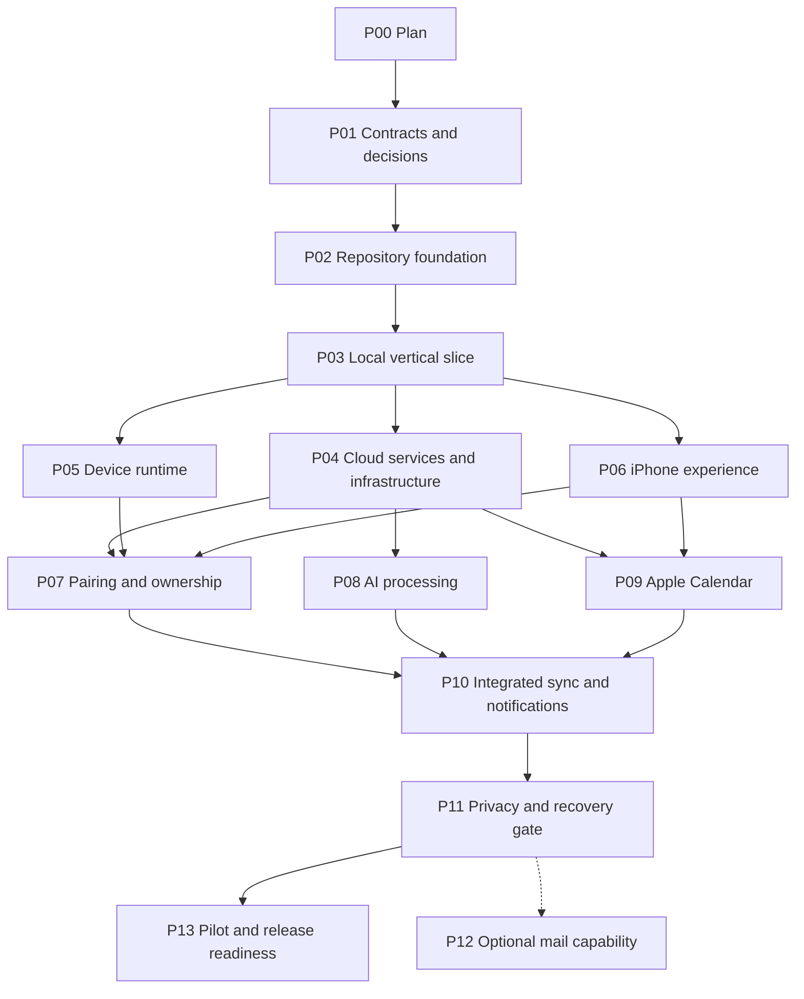

# Implementation plan

This plan is organized into dependency-gated phases. It is not a calendar estimate or a standing instruction to run every phase. [STATUS](STATUS.md) is the authoritative progress ledger. Each phase needs a handoff, a source revision, relevant test evidence, and an explicit distinction between local verification and approved live verification.

## Dependency map

Independent lanes after P03: backend/infra P04, device P05, and iOS P06. After their prerequisites pass, processing P08 and calendar P09 can proceed independently. P07 is coordinated integration work. P12 is optional; its deferral does not block P13.

Privacy and isolation are implemented in every relevant phase. P11 verifies them across the integrated system; it is not permission to postpone authorization or deletion design until the end.

## Phase card rules

Every phase below identifies dependencies, a suggested owner role, file scope, deliverables, checks, and a completion gate. An agent can prepare later-phase designs while dependencies are pending, but must not mark implementation complete against imaginary interfaces. Required live checks stay explicitly blocked until the relevant environment/build is approved.

### P00: Architecture and work plan

- **Depends on:** none.
- **Owner:** coordinator.
- **Scope:** README, AGENTS, and docs.
- **Deliver:** architecture, contracts draft, decisions, phase graph, status ledger, verification gates, and handoff template.
- **Check:** local links, sample JSON, phase references/dependencies, no unsupported implementation claims, no personal data or secrets.
- **Gate:** documentation is internally consistent and the next phase is explicit. P00 does not count as working software.

### P01: Freeze contracts and resolve interface decisions

- **Depends on:** P00.
- **Owner:** coordinator with input from hardware and iOS/backend owners.
- **Scope:** `contracts/`, fixtures specification, decisions, contracts documentation.
- **Deliver:** OpenAPI v1; JSON Schemas for capture, manifest, device commands, calendar snapshot, observation, recap, and user edits; legal state transitions; valid/invalid examples; authorization rules; timezone policy; upload acknowledgement semantics.
- **Decisions to settle:** minimum iOS version, Pi/OS and BLE capability, physical possession confirmation, location source, pause/resume behavior, local storage/key strategy, and prototype retention. Cloud account/region can remain a named blocker for live work while local contracts proceed.
- **Implementation steps:** turn prose fields into bounded schemas; define stable IDs and revision behavior; create synthetic examples for manual/nightly sync and failures; explicitly record approved defaults versus unresolved hardware decisions.
- **Check:** schema validation; invalid identity/epoch/version cases; state transition coverage; time examples for midnight, travel, DST, and an incorrect clock; incomplete calendar snapshot; idempotent replays with changed payloads.
- **Gate:** contracts can be implemented independently without inventing field meanings. Any unresolved transport detail has an adapter interface and a blocker assigned to P07, not an invented working connection.

### P02: Establish reproducible local development

- **Depends on:** P01.
- **Owner:** coordinator/tooling owner.
- **Scope:** workspace configuration, `apps/ios/`, `services/`, `device/`, `infra/`, local check tools.
- **Deliver:** minimal buildable SwiftUI project; TypeScript backend/infra workspace; Python package and device simulator entry point; pinned toolchains/lockfiles; environment variable template containing names only; documented finite local commands.
- **Implementation steps:** choose supported runtime versions; set up format/type/build/test commands; add protocols/adapters; provide a repository root check command that runs only explicit local checks. Keep dependency installation separate from cloud setup.
- **Check:** clean checkout can build the iOS simulator target and import/run Python/TypeScript modules; shared fixture decoding works in all three languages; CDK synthesizes an empty/minimal local app without credentials or provider lookups.
- **Gate:** another agent can reproduce the local baseline from documented prerequisites. No CI workflows, git hooks, unattended watchers, or dependency-update bots are activated without separate approval.

### P03: Demonstrate the full local flow with fixtures

- **Depends on:** P02.
- **Owner:** integration owner.
- **Scope:** synthetic fixtures, simulator, local backend adapters, minimal iOS fixture client, local harness.
- **Deliver:** deterministic capture-to-recap flow with no live AWS calls or paid model calls. A mock observation provider returns fixed structured data, not arbitrary prose embedded in views.
- **Implementation steps:** generate a sample day; snapshot and upload into a local object-store adapter; verify the manifest; run a deterministic processing job; fetch it through the API abstraction; show a recap; save a reflection/correction; add a second snapshot and update the day.
- **Check:** duplicate upload, checksum failure, restart mid-upload, unknown device, deleted capture, stale recap publication, and preservation of user edits. Inspect simulator screens for empty, pending, partial, ready, and offline states.
- **Gate:** one repeatable command runs the local scenario and produces a test report plus an inspectable UI result. Every screen is clearly connected to fixture/domain state. This proves contracts and user flow, not cloud/hardware reliability.

### P04: Implement cloud foundations, API, and ingestion

- **Depends on:** P03.
- **Owner:** backend/infra owner.
- **Scope:** `infra/`, `services/backend/`, persistence/AWS adapters, contracts implementation.
- **Deliver:** CDK Data/Runtime stacks; Cognito JWT API; ownership checks; DynamoDB access patterns; private S3 upload/read grants; IoT topic policies and handler; manifest verification; durable job outbox; media tombstone checks; minimal deletion operations; observability without source contents.
- **Implementation steps:** write scoped IAM and persistent resources; implement profile/device/day routes; add conditional ownership and idempotency writes; implement grant renewal and immutable conditional PUTs; persist snapshot and outbox atomically; implement an explicit recovery command for undispatched work. Schedules stay disabled.
- **Check:** CDK synth and focused template assertions; handler tests with adapter fakes; multi-user authorization tests on every resource family; malformed manifests; object overwrite and wrong-hash retries; database/outbox crash boundaries. Test repositories against DynamoDB Local where feasible, documenting unsupported differences.
- **Local gate:** source builds, templates and policies are reviewed, and all local checks pass. Prepare an exact development deployment packet with resources, IAM diff, cost estimate, region/model assumptions, and rollback. Report ready to ship if the packet is not approved.
- **Live evidence:** only after approval, verify actual JWTs, IoT policies, S3 required headers/checksums, transactions, and outbox recovery using synthetic data. Record this separately; local emulators cannot certify AWS authorization.

### P05: Implement the durable device agent

- **Depends on:** P03.
- **Owner:** device software owner; hardware owner supplies interfaces.
- **Scope:** `device/`, simulator fixtures, hardware adapter documentation.
- **Deliver:** capture scheduler, local SQLite queue, atomic media writes, storage guard, pause gesture/rule adapter, screen state, clock/location metadata, resumable sync, and a persisted nightly schedule evaluator.
- **Implementation steps:** build against fake camera/IMU/display/connectivity first; add adapters for the approved Pi components; implement local key/storage choice; serialize sync attempts; freeze snapshots while capture continues; persist acknowledgements and cleanup eligibility; expose a finite diagnostic command.
- **Check:** kill/restart at each write/upload checkpoint; disk full; corrupt frame; clock correction; pause while capture is pending; reboot while paused; simultaneous manual/nightly triggers; URL expiry; intermittent Wi-Fi; DST and missed-window recovery. Measure hardware capture and gesture behavior only on the agreed prototype.
- **Gate:** simulator fault tests pass and hardware-dependent results are explicitly documented. Device installation and activation of a system service/nightly routine require approval for that build; provide how to stop the service and disable scheduled sync.

### P06: Build the native iPhone experience

- **Depends on:** P03.
- **Owner:** iOS owner.
- **Scope:** `apps/ios/`, fixture adapters, UI/accessibility tests.
- **Deliver:** Home/History/Device navigation; recap and moment detail; reflection/correction editors; cached reading; edit outbox; sync progress; settings; authentication adapter; pairing screens against a simulator.
- **Implementation steps:** create typed repositories/view models; implement local persistence/migrations; expose separate upload/processing/calendar states; add Sync now; build desired/applied configuration UI; route source deletion and offline edit conflicts; prepare BLE interface without claiming real pairing yet.
- **Check:** unit tests for view state/repositories; simulator UI journeys; large text, VoiceOver labels, denied permissions, expired login, no device, stale battery values, offline edits, interrupted sync, and recap regeneration preserving drafts. Inspect real rendered screens.
- **Gate:** the app builds locally and the core journey works with fixtures and the agreed API adapter. Any physical-device installation/TestFlight build requires its specific approval. No mail connection UI suggests unsupported functionality.

### P07: Integrate pairing, provisioning, and ownership

- **Depends on:** P04, P05, P06.
- **Owner:** integration owner with device and iOS owners.
- **Scope:** claim API, BLE/setup adapters, provisioning procedures, IoT identity policies.
- **Deliver:** signed-in phone -> temporary QR -> authenticated local connection -> Wi-Fi setup -> device cloud proof -> atomic owner binding -> acknowledged configuration.
- **Implementation steps:** use a unique prototype device certificate; confirm BLE security/physical proof choice; implement expiring claim lifecycle; add retry/reset/transfer behavior; revoke prior pairing material on ownership epoch change; write provisioning and factory-reset procedures.
- **Check:** reused QR, wrong device, expired claim, two claimants, lost BLE link, wrong Wi-Fi password, cloud disconnect, old ownership epoch, reset while offline, and a former owner attempting access. Confirm Wi-Fi credentials/private keys never reach logs or cloud payloads.
- **Gate:** simulated threat cases pass; then an approved physical-device/development-environment run pairs and re-pairs successfully. If hardware transport or provisioning access is unavailable, mark live verification blocked and keep fixture implementation evidence separate.

### P08: Implement and evaluate the recap pipeline

- **Depends on:** P04.
- **Owner:** processing owner.
- **Scope:** `services/processing/`, workflow definition, prompt/config versions, synthetic evaluation corpus.
- **Deliver:** Step Functions workflow, bounded observation workers, timeline assembly, source validation, synthesis, conditional publication, partial/failure states, usage measurements, and replay-safe processing.
- **Implementation steps:** retain the mock provider; implement Bedrock adapter; verify model availability in chosen region; compare Haiku observation candidates and Opus versus a cheaper synthesis candidate; set token/concurrency/retry limits; cache successful observations; validate every source reference; make deletion/supersession checks before publication.
- **Check:** deterministic pipeline tests; unsupported image; low-quality image; throttles; model timeout; invalid JSON; hallucinated source ID; photographed prompt injection; partial coverage; stale input revision; deletion during synthesis; and notifications emitted only after valid publication.
- **Evaluation gate:** define a finite sample count and spend cap before paid tests. Human review assesses factual support, coverage, useful reflection, and correction behavior. Stop and diagnose a batch with roughly more than 20% failures. Do not declare success from JSON validity alone.
- **Gate:** local workflow checks pass and a documented, approved finite model evaluation supports the selected configuration. If model access/cost approval is missing, keep live evaluation blocked rather than substituting an untested model silently.

### P09: Add Apple Calendar context

- **Depends on:** P04, P06.
- **Owner:** iOS/integration owner.
- **Scope:** EventKit adapter, consent/selection UI, calendar snapshot API and reconciliation.
- **Deliver:** permission explanation, selected-calendar filtering, bounded event snapshots, upload consent, source provenance, freshness UI, disconnect/deletion, and recap input revision updates.
- **Implementation steps:** request full-access permission only when the user enables integration; behave read-only; default to title/times/location; stage paginated snapshots and publish atomically; reconcile edits/cancellations within covered windows; handle new source generations and permission revocation.
- **Check:** denied/revoked access; empty selected calendar; failed versus complete empty refresh; all-day and recurring events; cancelled occurrences; DST; calendar/account re-add; phone offline overnight; partial page upload; and planned activity mistakenly presented as observed activity.
- **Gate:** mock adapter tests pass, the permission flow is inspected, and an approved device test with a synthetic calendar verifies actual EventKit behavior. Nightly device processing succeeds when the phone does not refresh at the requested time.

### P10: Integrate manual sync, nightly sync, and notifications

- **Depends on:** P07, P08, P09.
- **Owner:** integration owner.
- **Scope:** device/app/backend integration, schedule settings, notification adapter, cloud recovery procedure.
- **Deliver:** one shared sync engine; connected/nearby command routing; Today so far and later nightly revision; coalesced requests; honest progress; local-time schedule configuration; generic APNs notifications; missed-run recovery.
- **Implementation steps:** run a finite simulated day first; add physical/cloud paths; validate desired/applied settings; support opt-out and cancellation; register push tokens; define invalid-token cleanup; add explicit reconciliation for outbox/recovery failures. Before unattended use, choose either approved bounded automatic reconciliation or an assigned operator recovery procedure/response target. Describe any recurring cloud check's frequency, data touched, cost, and stop procedure separately.
- **Check:** repeat taps, remote offline device, BLE control with no internet, hotspot/Wi-Fi interruption, charging preference, duplicate scheduled window, midnight upload, two-day backlog, later calendar refresh, notification failure, and disabling automatic sync while the device is offline.
- **Approval gate:** prepare the exact app/device/cloud candidate and an automation activation description. Each installation/deployment and the recurring behavior needs recorded approval. The plan itself is not activation approval.
- **Gate:** approved integrated evidence covers both daytime and nightly behavior, including a test that prevents the iPhone app from running overnight. No lost or duplicated captures and no overwritten reflections/corrections.

### P11: Verify privacy, deletion, and operational recovery

- **Depends on:** P10.
- **Owner:** integration/security reviewer role.
- **Scope:** deletion workers, policies, retention controls, logs/metrics, recovery and backup procedures.
- **Deliver:** verified per-user isolation; immediate tombstones; complete dependent-data removal; offline-client cleanup status; stale-job rejection; retention disclosure; operational runbook; bounded recovery commands; cost/usage controls.
- **Check:** cross-user access for every API/topic/object/job; deleted input re-upload; deletion during processing; all S3 versions if enabled; app cache cleanup; disconnected-device cleanup; token/permission revocation; backup restore with deletion-ledger replay; expired signed URLs; log scrubbing; queue/outbox recovery; and stalled job alarms.
- **Gate:** no critical privacy defect, no unbounded retries, and no unsupported deletion promise. Residual limitations, including physical device storage protection and backup expiry, are documented. Real personal pilot data is prohibited until this gate passes.

### P12: Investigate and optionally implement mail

- **Depends on:** P11 for implementation; read-only feasibility research may occur earlier.
- **Owner:** integrations owner.
- **Scope:** provider capability note first; provider adapter, consent, secret storage, and tests only after scope is selected.
- **Deliver:** evidence for a supported iCloud/provider authorization route, exact scopes/data selection, disconnect/revocation behavior, token handling, ingestion boundaries, and cost/rate constraints. If support is impractical, record a deferred result and leave the MVP intact.
- **Implementation steps if approved:** connect the underlying provider; read only selected contextual messages; normalize safe evidence records; prevent mail content from acting as instructions; update affected day input revisions; remove imported data on disconnect as configured.
- **Check:** revoked/expired credentials, repeated messages, IMAP UID validity changes if applicable, deleted messages, provider throttling, malicious content, empty filters, disconnect cleanup, and absence of any send/delete/archive permission or behavior.
- **Gate:** a supported route is actually verified with an explicitly connected test account. Apple Mail on iOS or Sign in with Apple alone is not accepted as proof of mailbox access. This phase may remain deferred at release.

### P13: Pilot, hardening, and release readiness

- **Depends on:** P11. P12 is optional.
- **Owner:** coordinator/release owner with hardware owner.
- **Scope:** finite field tests, accessibility/polish, deployment packet, operations documentation.
- **Deliver:** one-user/one-device pilot report; battery/storage/upload/model measurements; defect triage; rollback tested on the candidate; user-facing permission/retention language; exact release candidate identifiers and resource diffs.
- **Check:** an approved full-day pilot, deliberate pause/resume, two sync modes, offline recovery, capture coverage, permissions, timezone changes, deletion, and physical device thermal/power behavior owned by the hardware team. Review factual recap quality with the participant.
- **Proposed pilot targets:** no cross-user access, no capture after a confirmed pause, no loss of unacknowledged captures across tested crashes, no duplicate moments after replay, all published factual highlights trace to valid sources, and preserved user edits after every refresh. Upload/recap latency and battery targets are set from P05/P08 measurements rather than invented here.
- **Gate:** all must-pass checks are evidenced and limitations are written. Report ready to ship with a concrete candidate; stop before TestFlight upload, device rollout, or production deployment until that exact ship is approved. A previous development approval does not cover this release.

## Agent assignments and handoff discipline

The coordinator claims work in STATUS before implementation and assigns file boundaries. For an explicitly authorized parallel session, use at most one writer per boundary: backend/infra, device, iOS, or processing. One agent can fill several roles sequentially. Do not spawn agents merely because this plan lists roles.

Shared schemas, root dependencies, infrastructure identifiers, and Xcode project files need a single owner for each change. Other agents propose changes in their handoffs rather than racing to edit them. Use integration fixtures for cross-component review instead of relying on prose assurances.

Each work package should fit one reviewable source change, include its required checks, and leave a handoff even when blocked. A phase can require several work packages. The next agent starts from the latest source and evidence, verifies the phase dependencies, and continues at the first unmet acceptance condition.
